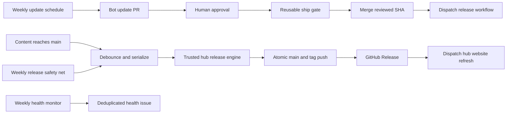

# Skill automation

This directory documents the shared update, release, validation, and repository-health automation for the skill collections. The hub owns reusable workflows and the release engine; spoke repositories call those workflows by ref and supply their own target repository context.

## Architecture

`reusable-skill-release.yml`, `reusable-skill-ship.yml`, `reusable-skill-validate.yml`, and `reusable-repo-health.yml` are the shared interfaces. Thin hub callers are `release.yml`, `auto-ship.yml`, `validate-skills.yml`, and `repo-health.yml`. The spokes call the reusable workflows from `webmaxru/ai-native-dev` and keep their own update workflow and bot PR generation.

## Controls

Repository variables:

- `AUTO_RELEASE=false` disables releases caused by pushes, the schedule, and approve-to-ship dispatches. Intentional human manual dispatch remains available.
- `AUTO_SHIP=false` disables automatic merging after approval.

The human approval is mandatory for bot-generated update PRs. Release validation and previews are read-only; the ship gate re-fetches the current PR and approval, validates the exact head SHA, and only merges `skills/NAME/**` changes. No workflow executes skill scripts from a PR.

## Rollout

1. Merge the hub release engine and reusable workflows first. This change modifies `skills/agent-skill-deploy`, so its first merge is itself eligible for the initial hub release.
2. Merge the hub's weekly-update caller change.
3. Merge spoke callers for `webmaxru/web-ai-agent-skills` and `webmaxru/enonic-agent-skills`; their `@main` reusable references require step 1 to be present.
4. Verify each repository's required Actions permissions and enable its health workflow. Do not add a cross-repository write token; public spoke health checks are read-only.

The current implementation PR must remain open for its owner to merge. The owner merges the hub layers before the spokes; automation does not merge its own implementation.

## Boundaries

The health workflow can re-enable a workflow disabled for inactivity only when it runs. A fully disabled hub health workflow cannot wake itself; the hub's schedule monitors public spokes but is not a universal perpetual-keepalive guarantee. See [release operations](release.md) for debounce, recovery, and manual fallback details.
