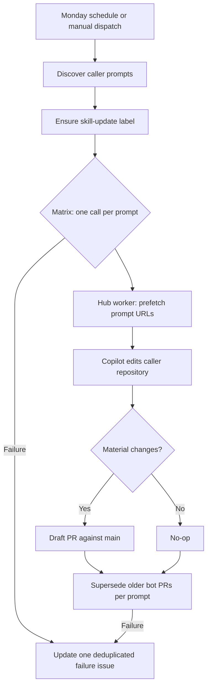

# Weekly skill updates

The hub owns the shared GitHub Agentic Workflows worker and the superseding logic. Each repository keeps a small caller that discovers its own prompts and invokes the worker; the worker reads prompts, skills, and the default branch from the calling repository.



## Add a prompt

1. Add `.github/prompts/<slug>-skill-update.prompt.md` to the repository.
2. Keep the prompt focused on one skill update. Put supplied prompt text first, then supplied attachments, then the prompt's built-in URLs when reconciling sources.
3. Use repository-relative links for local references. The worker prefetches URLs before the agent starts and records the URL-to-file map under `.github/aw/prompt-sources/`.
4. Run **Actions → Weekly Skill Updates → Run workflow**. Leave `prompt_path` empty to run every prompt, or set it to the full `.github/prompts/<slug>-skill-update.prompt.md` path to run one.

The worker creates at most one draft PR per prompt, with the `skill-update` label and `main` as its base. Runs without material changes report a no-op. The weekly caller supersedes older bot-authored PRs for the same prompt after the matrix finishes.

The worker prefetches prompt context in `pre-agent-steps`, after gh-aw's optional PR-branch checkout, so the generated `.github/aw/` files remain available to the agent on both dispatch and PR-event runs.

## Roll out to another repository

1. Add a `*-skill-update.prompt.md` file under `.github/prompts/`.
2. Add the thin caller workflows: `weekly-skill-updates.yml`, `release.yml`, `auto-ship.yml`, `validate-skills.yml`, and `repo-health.yml`. Copy the hub versions, retaining that repository's schedule time and any repository-specific defaults.
3. In `weekly-skill-updates.yml`, use the shared hub workflows:

   ```yaml
   uses: webmaxru/ai-native-dev/.github/workflows/skill-update-worker.lock.yml@main
   ```

   ```yaml
   uses: webmaxru/ai-native-dev/.github/workflows/reusable-skill-update-supersede.yml@main
   ```

4. Use `main` as the target repository's default branch; the shared worker explicitly creates PRs against `main`. Grant the worker call job `actions: read`, `contents: write`, `issues: write`, and `pull-requests: write`. Grant the supersede job `contents: write`, `issues: write`, and `pull-requests: write`. Keep the discovery job read-only.
5. Pass the Copilot token explicitly; personal-account repositories should not rely on `secrets: inherit`:

   ```yaml
   secrets:
     COPILOT_GITHUB_TOKEN: ${{ secrets.COPILOT_GITHUB_TOKEN }}
   ```

6. Configure the required `COPILOT_GITHUB_TOKEN` secret in the repository. No additional PAT or GitHub App secret, branch protection, or app credential is required for the weekly flow.

The hub repository calls its own reusable workflows with local `./.github/workflows/...` references. Roll out only after the hub's shared workflows are merged to `main`.

## Upgrade the shared worker

Upgrade and compile the worker in the hub only:

```bash
gh aw upgrade --skip-extension-upgrade
gh aw compile --no-check-update
```

Review the generated `actions-lock.json`, agent/skill assets, and worker lock file. Commit the generated upgrade separately from workflow-source edits, then compile again after changing the worker markdown. Spokes consume the published hub lock and should not maintain copies of the shared worker.

## Troubleshooting

| Symptom | Check |
| --- | --- |
| Copilot CLI reports a missing `copilot_driver.cjs` module | Verify the hub lock was compiled with the current gh-aw version and that the caller uses the shared lock from the intended hub ref. |
| Matrix jobs cancel one another | Confirm `concurrency.job-discriminator` uses `inputs.prompt_path` in the hub worker and inspect the compiled conclusion job group. |
| A worker cannot read its prompt or create a PR in the spoke | Confirm `inlined-imports: true`, the caller's `prompt_path`, explicit `COPILOT_GITHUB_TOKEN` mapping, and the worker call permissions. |
| PR creation fails while adding a label | Ensure the caller's `issues: write` permission lets the label setup job create `skill-update`. |
| A run fails without a report | Check the caller's failure-reporter job and `issues: write`; it updates the single issue titled `[skill-update] failed weekly skill updates` with the latest run URL. |
| An older PR stays open | The superseder only handles open `[skill-update] SLUG: ...` PRs authored by `github-actions[bot]` whose commits are all bot-authored. It leaves human-authored or mixed-authorship PRs alone. |
| A worker PR targets the wrong branch | Confirm `base-branch: main` is present in the compiled `create-pull-request` configuration. |
